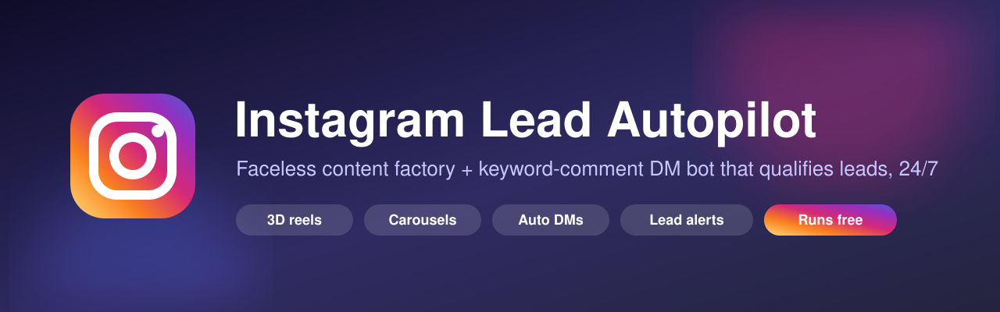
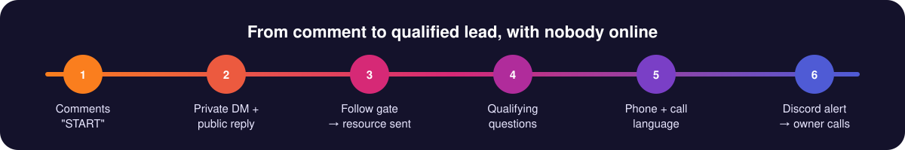
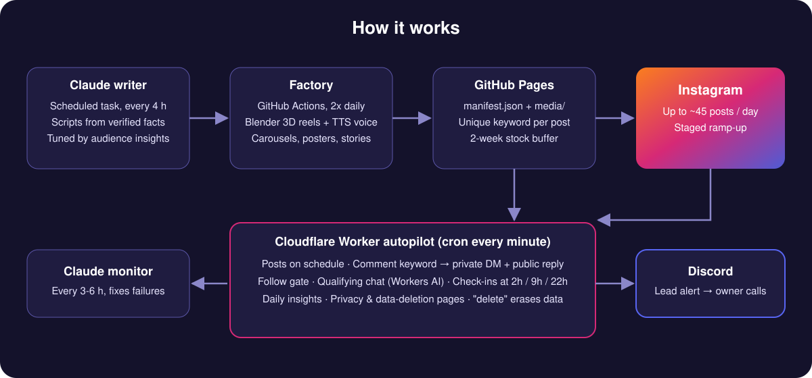

<p align="center">
  
</p>

<p align="center">
  
  
  
  
  
  
</p>

<p align="center"><b>A faceless Instagram account that posts every day and turns comments into qualified, called-back leads.</b><br>
The owner's only daily job: call the leads that land in Discord.</p>

---

## ✨ What it does

| | |
|---|---|
| 🎬 **Content factory** | Scripts become 3D two-person dialogue reels (50 locations), chat reels, list reels, carousels, 4:5 posters and 9:16 stories, with TTS voice-over and covers. |
| 🗣️ **Natural Indian voices** | Voice-overs come from AI4Bharat's open-source [Indic Parler-TTS](https://huggingface.co/ai4bharat/indic-parler-tts) model on Hugging Face. It runs free inside GitHub Actions, supports Malayalam, Hindi, Tamil and other Indian languages, and saves every line so it is never generated twice. |
| 💬 **Comment → DM** | Every post carries a unique comment keyword. A comment triggers a private DM plus a public reply, a follow gate, then the promised resource. |
| 🎯 **Lead qualifying** | A friendly DM chat (free Workers AI) asks your questions: need, team, traction, timeline, phone, call language. |
| ⏰ **Check-ins** | People who go quiet get a nudge at 2 h, 9 h and 22 h, restating the exact question they stopped on. Quiet hours respected. "stop" opts out. |
| 🔔 **Lead alerts** | Complete leads ping Discord with @everyone so the owner's phone rings. |
| 📈 **Self-tuning** | Daily insights rank content by leads per 1,000 reach; the Claude writer shifts toward winners while keeping exploration. |
| 🔐 **Privacy-ready** | Built-in privacy, terms and data-deletion pages; typing "delete" in DM erases the person's data. |
| 💸 **Runs free** | GitHub Actions + Pages on a public repo, Cloudflare Workers free tier. Claude is used only for writing and monitoring. |

## 🖼️ The 3D scenes

<p align="center"></p>

Rendered with Blender in GitHub Actions. Locals will recognise them: a thattukada, a ferry, Munnar tea hills, an Akshaya centre, a Gulf room and more. Swap or add locations to match your audience.

## 🔁 From comment to lead

<p align="center"></p>

## 🏗️ Architecture

<p align="center"></p>

## 📁 Repo layout

```
business.json      everything business-specific (brand, language, keywords, DM questions, schedule, facts)
bank/              scripts for reels, carousels, posters, stories (examples are placeholders)
factory/           renderers: 3D duo reels, chat/list reels, carousels, posters, stories, voice
worker/            Cloudflare Worker autopilot (posting, DMs, check-ins, alerts, insights)
setup/             configure.mjs, gen-config.mjs, fonts.py, SETUP.md, LANGUAGES.md
skill/             the Claude skill that sets the whole thing up for you
.github/workflows/ factory, scene renders, worker deploy, post-now
```

Nothing outside `business.json` names a business, so one template serves any niche and any language. It ships configured for Malayalam (Anek Malayalam fonts and Malayalam TTS voices).

## 🚀 Quick start

1. **Install the skill.** Add [`skill/instagram-lead-autopilot/SKILL.md`](skill/instagram-lead-autopilot/SKILL.md) to Claude as a skill.
2. **Create the accounts** listed in [`setup/SETUP.md`](setup/SETUP.md) (GitHub, Cloudflare, Meta developer, Discord, Hugging Face) and stay logged in.
3. **Say "start".** Claude interviews you once, researches your niche's verified facts, creates your repo from this template, fills `business.json`, wires up Meta and Cloudflare, writes two weeks of content and schedules its own refill writer and monitor.

Or by hand:

```bash
gh repo create <you>/<name> --template Shaazamaan/instagram-lead-autopilot --public
node setup/configure.mjs <you>/<name> <IG_USER_ID> <workers-subdomain>
node setup/gen-config.mjs
```

Repo secrets: `CLOUDFLARE_API_TOKEN`, `IG_TOKEN`, `DISCORD_WEBHOOK`, `HF_TOKEN`. Variables: `WORKER_URL`, `IG_USER_ID`.

`HF_TOKEN` is a free Hugging Face read token. The factory uses it to download the Indic Parler-TTS voice model.

## ⚠️ Battle-tested pitfalls (already handled)

- Duplicate webhooks from two Meta apps are deduped by comment and message id, never by message text.
- One private reply per comment; DMs only inside the 24 h window; quick-reply titles ≤ 20 chars.
- ~100 API posts per 24 h per account; staged ramp from ~15 to ~45 posts a day.
- Message webhooks need a **Published** app. The Instagram-login tester route avoids App Review.

## 👤 Author

Built by **Shaazamaan Shaji**, an AI-enabled solo operator from Alappuzha, Kerala. Proven in production on a Malayalam company-registration account.

[LinkedIn](https://www.linkedin.com/in/shaazamaan-shaji/) · [Instagram @executionwithshaaz](https://instagram.com/executionwithshaaz)
